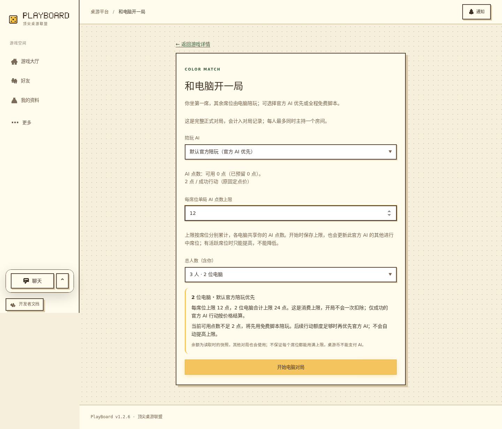
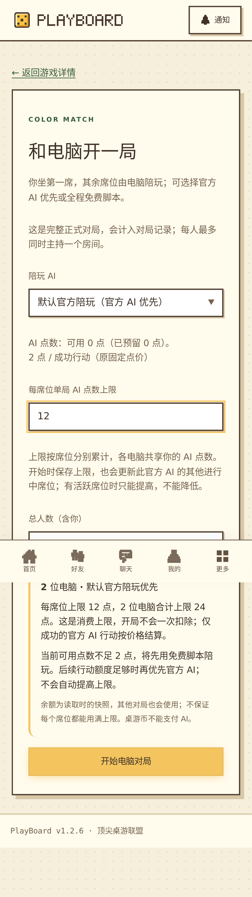

# D10 电脑陪玩说明（2026-11-12，候选 1.2.6）

本轮继续每日计划的 D10，帮助玩家在开局前理解官方 AI 优先、免费脚本、价格与预算。基于最新 main `120976e` / 1.2.5，在独立 `codex/d10-computer-help` 工作区开发；原目录和其他任务的未提交改动保持。

## 实现与边界

原电脑开局页已有官方优先和免费回退，但缺少随人数变化的预算合计，余额不足也只显示数字。沿用同一路由和表单，在开始按钮前增加「本局陪玩与预算」摘要：

- 人数和每席位上限联动，例如 3 人局有 2 位电脑，每席位 12 点，合计上限 24 点。明确这是消费上限，开局不一次扣除；各席位共享钱包，余额是读取时快照，不保证每席位用满。
- 同时显示可用/已预留 AI 点数，复用原价格组件。固定计价不足一次行动价格时提示先用脚本；token 计价至少 1 点即可尝试，不能将单次预留上限误当最低余额。
- 明确余额或该席位额度不足时免费脚本接续，后续有额度再优先官方 AI，不自动提高上限；免费脚本选择和无官方档位分别说明，不使用官方模型、不扣 AI 点数。桌游币不能支付 AI。
- 开始时保存上限会影响同配置其他进行中席位，有活跃席位只能提高、不能降低。刷新恢复展示原请求锁定的人数、陪玩方式及预算，不拿重新加载的默认配置替换原操作。

保留原启用→建房→准备→开局链路、sessionStorage 原请求恢复、权限、事务、计费和脚本回退。不新增 API、迁移、SDK、依赖、游戏实现或付费调用；游戏来源锁与官方登记无变化。

平台 **1.2.5 → 1.2.6（PATCH）**：已有开局页的局部说明与反馈优化，README 同步；其他包及游戏版本保持。

## 实际验证

数据库使用既有 PostgreSQL 17 专用测试容器回环 15441 的新库 `playboard_d10_test_20261112`；运行前核对与 scratch/开发/生产库不同。集成结束后才串行运行 E2E，保留原准备、迁移、游戏同步和隔离媒体校验链。以下 pnpm 命令统一带 `--config.verify-deps-before-run=false`，避免重复检查已冻结安装的依赖。

| 命令 / 检查 | 实际结果 |
| --- | --- |
| `pnpm install --offline --frozen-lockfile` | 成功，无依赖/锁文件变化；首轮沙箱无法写缓存 SQLite 索引，正常权限下同命令成功 |
| `pnpm typecheck` | 全工作区与测试配置通过 |
| `pnpm lint` | ESLint、20 个源码根 AST 边界与格式检查通过；初次 tsx IPC 被沙箱拒绝，正常权限下通过 |
| `pnpm build` | 全工作区、生产 bundle/API runtime、受限 ZIP 恢复和 AI worker 检查通过；保留既有大 chunk 提示 |
| `pnpm exec playwright test --config tests/config/ui.config.ts tests/e2e/computer-help-ui.spec.ts --output .data/d10/ui` | 6/6，通过；受控公开 DTO 的生产预览，不冒充真实联机 |
| `pnpm test:integration tests/integration/official-ai.test.ts --testNamePattern='uses free script for an unfunded\|keeps a .* computer seat playing free\|respects a remaining budget'` | 定向 5/5，通过；原入口合并目录参数，另 245 项被名称过滤未执行，不宣称全量集成通过 |
| `pnpm test:e2e --config .data/d10/e2e.config.ts tests/e2e/computer-results.spec.ts` | 桌面/手机共 6/6，通过，无 skip；临时配置保留原 globalSetup/fixtures，仅延长单例超时并关闭含会话的 trace |
| 版本、差异、图片 | 根版本/README 一致，`git diff --check` 通过；实际查看桌面/手机真实 E2E 和暗色 320px 生产预览截图 |

生产页面回归覆盖 1440×900、1280×900、390×844、320×844，亮暗主题、正常/减少动态效果、键盘从人数到开始按钮、价格切换、无档位、读取失败/禁用、显式免费选择、编辑不写请求和错误重试。整页无检查到的横向溢出。

真实 E2E 使用 session/API/WS/权威规则与独立数据库，验证零点数官方配置由免费脚本继续行动、上限 12 的原启用请求在回复丢失/刷新后保持、无档位不发启用请求，以及建房/开局丢回复时不重复。双端分别完成正式电脑对局、持久结算、历史筛选与再开局。额外定向集成验证固定价/token 两种模式的余额回退、补点恢复、到上限后免费继续且不提高上限，以及 token 剩余预算低于单次上限的合法调用。集成中的模型适配器为受控 mock；E2E 零点数阻止测试来源调度，没有调用真实供应商。

以下为本轮真实 E2E 开始前画面，只有测试身份与公开表单，无生产身份、验证码、邀请码或会话。长页截图中的固定底栏处于采集时视口位置，不代表页面流内布局：

## 交付状态与限制

本地实现与必要验证完成。开始及交付前已成功 fetch main，基线无新增差异；提交/推送/PR、合并和服务器结果在实际完成后另记，不能将候选视为上线。

生产只读核对 current.json 与运行目录 package.json 为 `120976e / 1.2.5`，`boardgame-local.service` active/running、NRestarts=0。服务器启动仓库仍有既有运维补丁与文档改动，本轮未覆盖、重启或手工触发更新。

未验证真实收费模型、物理手机、Safari/WebKit、完整屏幕阅读器、生产登录后开局或全库集成/E2E；本轮没有计费/权限/后端变化，不重复无影响全库回归。D3 生产注册闭环与 D5 新包发布/主动安装继续保留原条件。D11 UNO 手机行动属于下一独立主题，未推进。

## 提交与 PR（2026-11-12）

主提交 **688fcc87b47f78aeb12b15033563c1f6767e398e** 已推送至 `codex/d10-computer-help`，创建 [PR #67](https://github.com/PlayBoardgameTogether/PlayBoardgameTogether/pull/67)，面向 main、状态 open。GitHub 应用创建接口返回 403，命令行无独立登录；使用既有 Git HTTPS 认证在内存中传给 gh 后成功创建，没有输出或保存凭据。PR 可合并、当前无阻塞审查，pins 检查仍在运行；本记录不代表已合并或服务器已更新，功能分支保留。

## 已合并、上线与清理（2026-11-12）

- 交付前重新 fetch main，固定 PR head **934a7c849dcf734667cbec57225b5fbf60b2011c**，核对完整 13 文件/2 提交、pins success、无开放审查及 clean 合并状态；按持续服务器同步授权以 merge commit 合并 [PR #67](https://github.com/PlayBoardgameTogether/PlayBoardgameTogether/pull/67)，结果为 **deee8bdcb1cb5368be932637c96328c3b930ff0b**。合并树与候选一致，后续仅补文档，不重复无变化代码验证。gh GraphQL 汇总读取失败后改为 REST 核对与固定 SHA 合并，没有绕过保护或检查。
- 原服务器更新器跟踪 main、每五分钟检查，依次记录 preparing、backup started、backup verified、updated。新完整备份 **update-C5pRNx**，UTC 创建时间 **2026-11-12 03:07:35.991**，共 **76 文件 / 6,045,031 字节**；使用原 `verifyUpdateBackup` 核对文件集合、长度、SHA-256、PGDMP 签名及 previous=`120976e` / candidate=`deee8bd` 全部通过。未手动重启、并行维护或恢复生产库，既有运维补丁/配置/资源保持。
- 北京时间 **11:11:50**，私有 current.json、实际 API 进程 cwd、运行目录 package.json 一致为 **deee8bd / 1.2.6**；服务 active/running、NRestarts=0。匿名 Chromium 四视口 **1440×900、1280×800、390×844、320×740** 公网首页、详情及电脑页刷新均 200，ready 200/database.ready=true、页脚 1.2.6、pageerror 0、未发现整页横向溢出。匿名电脑入口保留登录限制，无生产账号、发信或建房操作；付费选择和预算联机证据仍来自前述隔离 E2E。
- 四视口实际 CSS 和 `ComputerGamePage` JS 均响应 200，逐字节 SHA-256 与运行目录构建文件相同，包含新摘要选择器/文案。实际查看 1440px 和 390px 公网截图；非秘密概要、完整日志与截图留于 `.data/d10/`，不提交生成物或私密配置。
- 首轮浏览器等待 networkidle 超时，HTTP 探测首页/ready 均 200；改用 DOM 就绪与页面要素后，第二轮因探针将含登录链接的提示段落作精确字符串匹配而中止。修正探针定位后最终四视口全部通过；导航取消引起的图片/统计请求 ERR_ABORTED 不计为 pageerror。生产代码未改、不隐藏失败、不用初轮结果冒充通过。
- 核实 PR 已 merged、main 包含交付且树相同、源 head 无新增、无其他开放 PR 使用、工作区干净后，用 `git branch -d` 清理本地 **codex/d10-computer-help**，远程用已合并 head 的期望 SHA 约束删除，完成 fetch/prune。独立工作区和证据保留，原主工作区的 36 项已有改动、其他任务分支保持。

D10 产品已上线，下一独立主题为 D11；D3/D5、真机/WebKit、完整屏幕阅读器与真实付费调用等前述限制保留。此后仅交付内部记录，版本保持 **1.2.6**，不为文档强制重启应用。文档分支的 PR/同步结果在本轮最终交付中说明。
