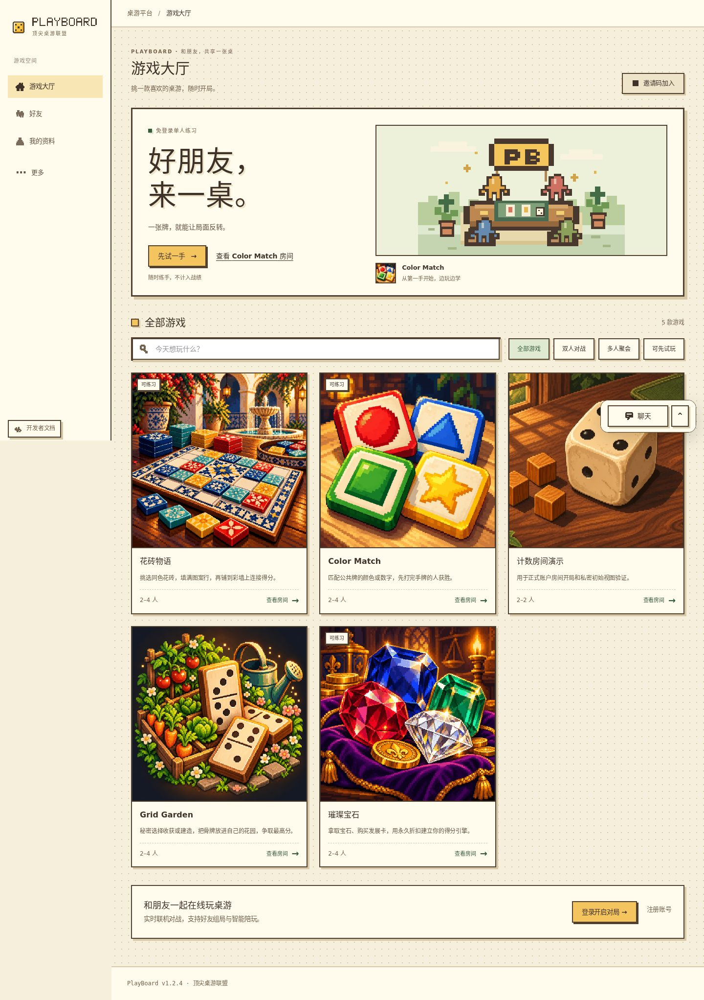
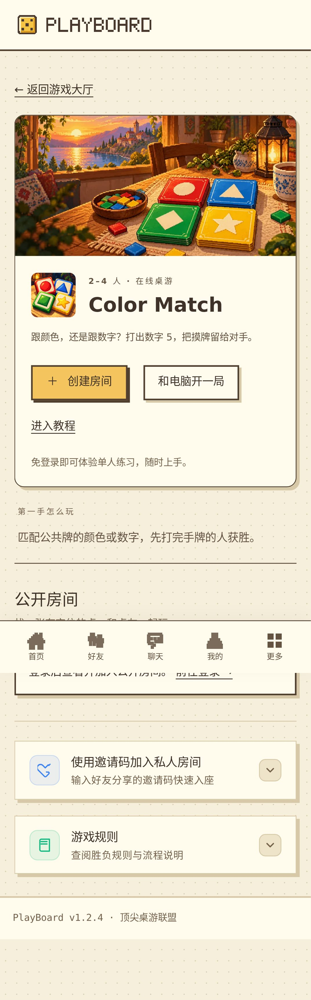
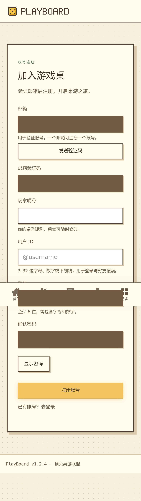
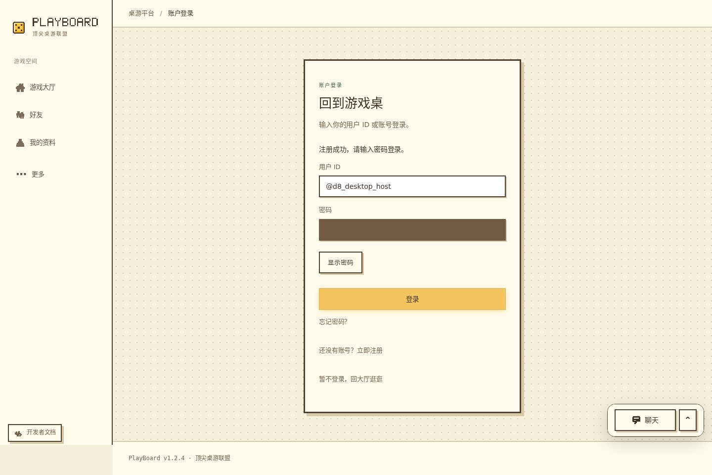
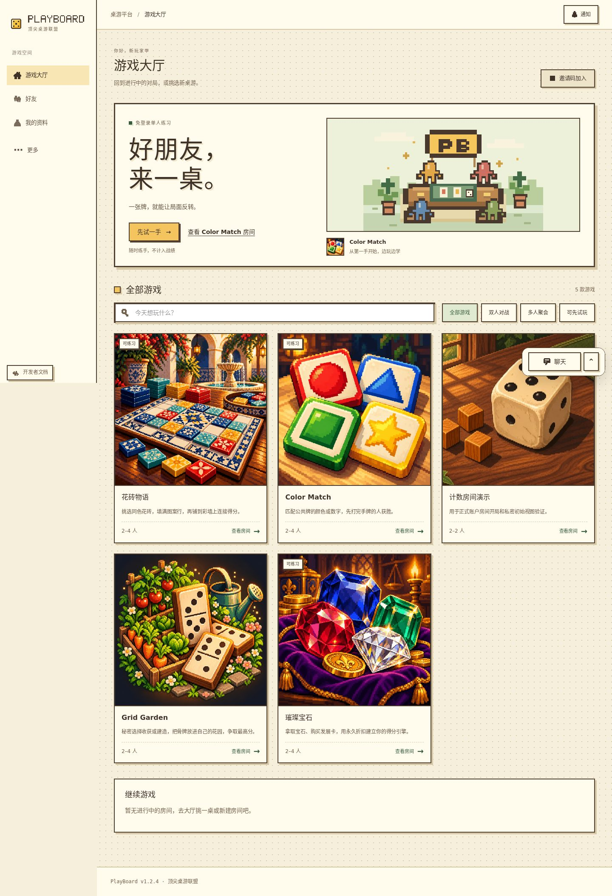
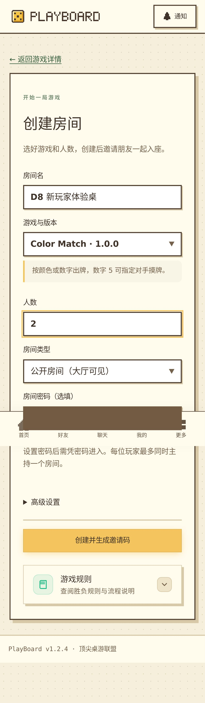
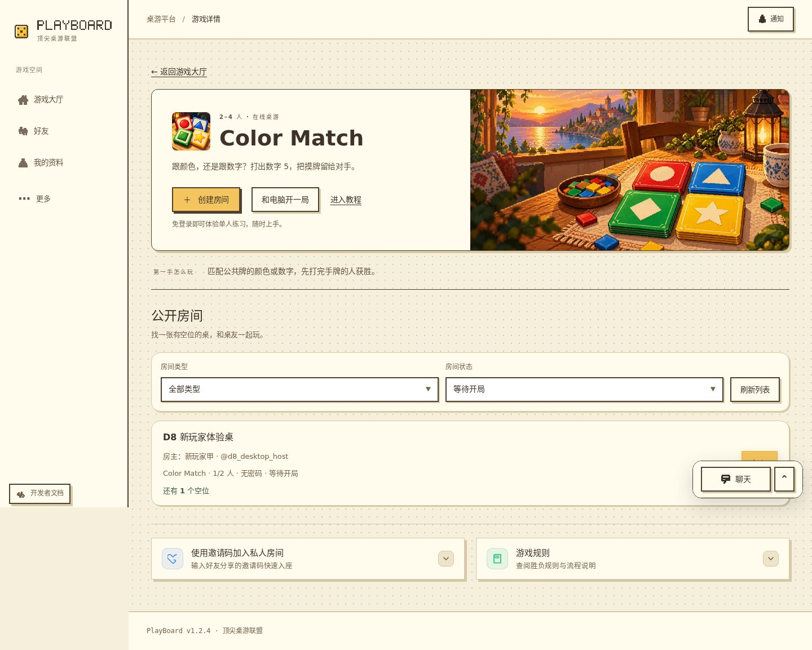
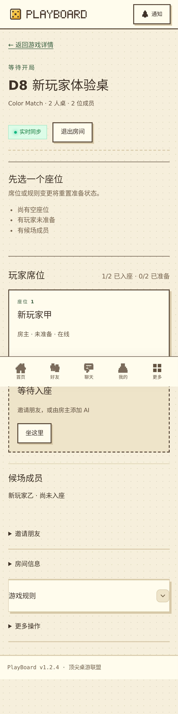
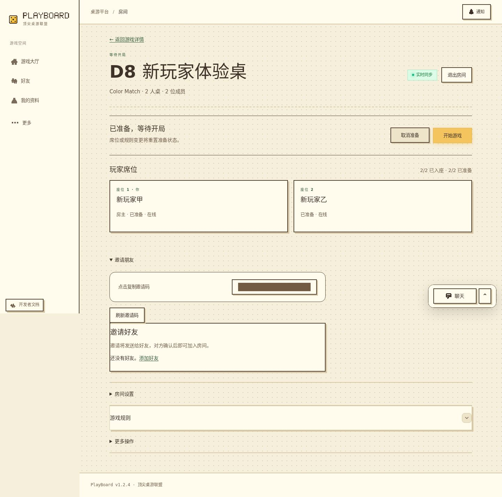
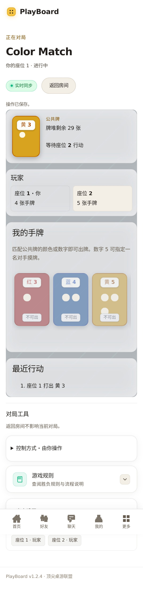

# D8 新玩家路径检查（2026-11-09）

新玩家可以完成注册、开桌和首个行动，但有两项实际阻力：**登录后丢失已选游戏与建房意图；桌面聊天浮窗遮住公开房间的加入按钮。** 本轮交付检查报告与 D9 修复方案，没有修改产品行为。

## 范围与证据

- 开始前成功 fetch main，从 `6bcb95c4d7e3585f90ca33aea6ceabb8a44e4d65` / **1.2.4** 建立独立 `codex/d8-new-player-audit` 工作区。原目录的已有改动、其他分支和旧 PR 保持。
- 使用仓库现有 Chromium/Playwright、API、数据库、session、HTTP/WS 和规则执行链。桌面 **1440×900**，手机 **390×844**、触屏模拟；每端两个通过网页新注册的独立账号，Color Match `1.0.0`、两人公开房间。
- PostgreSQL 17 使用既有专用测试容器的回环端口 **15441**，本轮新建 `playboard_d8_test_20261109`。执行前核对 scratch 与 TEST_DATABASE_URL 不同，均与开发/生产库分离；两端串行运行，保留原准备、迁移、游戏同步和资源校验链。
- 注册发码走真实 API 与验证码校验，邮件由现有 E2E 依赖注入投递到私有本地测试收件箱；没有真实 SMTP 或生产账号操作。测试环境目录含身份验收扩展，不代表生产游戏目录。
- 每端采集 13 个状态，逐步记录页面、焦点、视口与整页宽度。以下保留本轮最终运行的 **10 张代表性原始截图**，均实际打开检查；其余截图、临时审计脚本、日志和非秘密观测概要保留在本工作区忽略目录 `.data/d8/`。截图中的棕色块为采集时遮盖邮箱、验证码、密码和邀请码；未提交原值、cookie、秘密配置或完整 State。
- 长页截图中，固定底栏显示在采集时视口位置，不能将长图中部的底栏解释为页面流内布局。截图不能独立证明完整无障碍符合性。

## 七步实测

### 1. 访客浏览并选择游戏：可用

大厅可以在未登录时浏览，详情提供人数、第一手说明、创建、电脑陪玩及免登录教程。手机将主题图与说明改为纵向；暖色像素视觉和明显的创建入口可保留。本轮实际选择 Color Match，再点击创建；新建页验证会话后进入登录页。

### 2. 验证邮箱并注册：隔离链路通过

填写邮箱并申请验证码后，页面播报发送状态，焦点进入验证码框；填写昵称、ID、密码与确认密码后可以注册。验证码由测试收件箱读取，不来自 API 响应或公开页面。手机注册表单较长，需要纵向滚动，但提交可达、没有整页横向溢出；本轮没有把必要字段数量认定为缺陷。

### 3. 注册后登录：认证通过，任务衔接有问题

注册成功返回登录页，ID 已填写，密码为空，成功提示明确。输入密码登录后两端均回到 `/`，没有继续此前的建房流程；玩家必须重新点击原游戏与创建。这里是问题 **D8-01**，不是认证失败。

### 4. 重新选游戏并建房：通过

重新进入详情创建，游戏和精确版本正确带入；人数为 2，默认公开类型可见。提交后房主自动入座，生成的一次性邀请码只在本人响应中展示。高级 JSON 保持折叠，没有要求新玩家编辑规则数据。手机可滚动完成提交。

### 5. 第二账号加入并入座：可完成，桌面有遮挡

第二个新注册账号从相同游戏的公开列表找到房间。桌面默认位置的加入按钮中心落在聊天浮窗上，见 **D8-02**；普通浏览器点击在滚动调整后仍能加入，本轮没有使用强制点击、移除浮窗或直接 API 加入来绕过。

加入后保留“成员”与“座位”的区分：页面明确提示“先选一个座位”，显示候场成员及“坐这里”。两端点击座位后出现准备按钮，没有擅自自动占座或准备。

### 6. 双方准备并开局：通过

双方各自准备后，房主看到 2/2 入座、2/2 准备，开始游戏变为可用。开局前的空座/未准备提示与状态一致；两端通过原房间实时同步一起进入 revision 0 的正式对局。

### 7. 首个行动、保存与刷新：通过

通过当前行动者本人的手牌控件出一张合法牌，或在没有合法牌时使用原摸牌按钮。双方均观察到 revision **0 → 1**；行动者刷新后仍恢复 revision **1**。手机终态画面可见“操作已保存”、手牌数量变化及公开行动记录；未读取对方手牌来决定行动。

## 两项问题与简要方案

### D8-01 · P1：登录后丢失建房意图

- **页面与复现**：匿名从 `/games/color-match/1.0.0` 点击创建 → `/login` → 注册 → 返回登录 → 登录成功。实际进入 `/`；两端均需再选一次游戏和创建。证据为步骤一与三。
- **实现核对**：[NewRoomPage](../apps/web/src/pages/NewRoomPage.tsx) 的未认证跳转只传 `/login`；[RegisterPage](../apps/web/src/pages/RegisterPage.tsx) 注册后只传公开登录 ID；[LoginPage](../apps/web/src/pages/LoginPage.tsx) 成功后固定 `navigate('/')`。没有现成的建房意图恢复。
- **预期与方案**：D9 优先在既有站内导航状态中保留“为指定 gameId/version 创建房间”的非秘密意图，并在登录与注册往返时传递。登录成功后回原精确版本创建页；普通直接登录继续回大厅。页面只补一行“登录后继续创建……”，延续现有布局、主题和按钮。
- **验收条件**：覆盖已有账号登录、新注册后登录、登录失败重试、切到注册再返回、刷新及取消；版本已停用时沿用不可用反馈，不静默换版本。返回目标必须限制为已知站内业务路由，拒绝任意外部跳转；不将密码、验证码、邀请码或 session 放入 URL/持久缓存，不增加自动建房副作用。

### D8-02 · P1：桌面聊天浮窗覆盖加入按钮

- **页面与复现**：1440×900、默认收起的桌面聊天浮窗；登录后从大厅进入 Color Match 详情，列表只有一个公开等待房间，保持详情初始滚动位置。右侧“加入”的下部与浮窗重叠，见步骤五。
- **观测依据**：按钮矩形为 `x=1315, y≈799.78, width=64, height=44` CSS px，中心约 `(1347, 821.78)` 在视口内；`document.elementFromPoint` 命中 **chat-dock-toolbar**，没有命中按钮。普通自动点击后来通过滚动调整成功，因此不夸大成“完全无法加入”。手机未呈现桌面浮窗，不能将手机按钮处于折下解释为相同遮挡。
- **实现核对**：[ChatDock](../apps/web/src/social/ChatDock.tsx) 在桌面提供固定浮窗；[Lobby](../apps/web/src/pages/Lobby.tsx) 的房间行将主要加入操作放在右侧。问题涉及平台外壳与列表位置，不属于游戏规则。
- **预期与方案**：保留聊天可发现性，给收起浮窗与房间主要操作留出不重叠的布局空间；按实际测量选择容器预留或浮窗位置调整。不能仅把点击点移到按钮边缘或降低浮窗透明度作为修复。
- **验收条件**：1440/1280px、不同房间数量和滚动位置下，加入按钮可见且中心实际命中自身；键盘焦点不被浮窗完全遮蔽。继续检查聊天展开/收起、通知及手机相邻断点，不隐藏聊天功能或放宽房间权限。

**D9 内容取舍**：先解决 D8-01，再在同一开局范围处理 D8-02。沿用大厅 → 详情 → 既有认证页 → 既有创建页 → 房间 → 对局，不增加页面、另一套建房 API 或新的授权方式。桌面保持侧栏与并列操作，手机维持纵向表单及底部导航；保留明确入座、本人准备和房主开局步骤。以上是方案与后续验收条件，尚未实现。

## 实际命令与结果

| 命令 / 检查 | 本轮结果 |
| --- | --- |
| `git fetch origin main`、工作区/分支/远程/祖先检查 | 成功；旧分支落后且有其他任务改动，改用最新 main 独立工作区 |
| `pnpm install --offline --frozen-lockfile` | 冻结离线安装成功；初次沙箱不能写 pnpm SQLite 缓存，获准在原环境执行后成功，没有升级依赖 |
| 原 `pnpm --config.verify-deps-before-run=false test:e2e --config .data/d8/audit.config.ts` | 最终 **2/2，通过，无 skip**，32.9 秒为浏览器批次耗时，不含数据库/资源准备；每端两个新注册账号和真实房间/正式行动 |
| 同一命令首轮 | 两端均停在临时脚本误写的“摸牌”定位，超时；实际按钮为“摸牌或跳过并结束回合”。修正定位后从原隔离准备链重跑上述两端，没有改产品或削弱 revision/恢复断言 |
| 26 个状态宽度与浏览器异常 | 两端整页宽度均未超视口，pageerror **0**；桌面加入按钮中心命中聊天层。用例间 Vite 曾记录 WS ECONNRESET，最终连接/行动/刷新断言全部通过，不将其计成浏览器异常或隐去 |
| `node .data/d8/live-check.mjs` | 公网匿名双端首页/详情均 200；创建进入登录；ready 200、database.ready=true、无 pageerror/整页溢出。首次探针在路由切换后过早读取标题，改为等待标题实际渲染后通过 |
| 截图、文档链接、版本与 `git diff --check` | 全部通过；十张 JPEG 可解码、链接存在，30 日计划编号完整，README 与根版本均为 1.2.4 |

本轮没有修改运行代码或自动测试源码，因此不重复执行无变化的 typecheck、lint、单测、集成或生产 build。E2E 是为了获得 D8 的真实路径证据，不将临时截图场景或测试邮件投递说成生产收件/注册通过。

## 生产只读复核与交付边界

北京时间 **2026-11-09 23:16:53**，真实 `/opt/boardgame` 的私有 current.json、API 子进程 cwd 与运行 package.json 一致：**6bcb95c4d7e3585f90ca33aea6ceabb8a44e4d65 / 1.2.4**。`boardgame-local.service` 为 **active/running、NRestarts=0**；匿名 Chromium 1440×900 / 390×844 的 ready 与详情→登录路径通过。该 SHA 是 D7 后续文档合并结果；本轮没有部署新运行代码或重启服务。

平台仍为 **1.2.4 → 1.2.4**，README 一致。仅新增内部检查报告、截图并更新计划/进度，无游戏、SDK、依赖、协议、迁移、官方登记或来源锁变化；无生产发布、安装、发信、账号创建及模型调用。报告不属于生产运行所需文档，不为它改写线上工作目录或触发维护重启。

**未验证范围**：真实 SMTP 的注册闭环仍属 D3 待办；邀请码加入、密码房、收费模型、完整终局、320/1280px、暗色、软键盘、物理手机、Safari/WebKit、屏幕阅读器及完整键盘焦点路径均未在 D8 验收，不从本轮截图推断通过。D5 游戏候选发布/生产主动安装与旧 PR 收尾继续保留原条件。

本轮仅交付 D8 检查，D9 实现尚未开始。主提交 **d851799706a3ee4db13988a2bef7d5ad161aacf2** 已推送 `codex/d8-new-player-audit`，创建 [PR #64](https://github.com/PlayBoardgameTogether/PlayBoardgameTogether/pull/64)，面向 main，**尚未合并**；该分支仍承担待审查报告，继续保留。GitHub 连接器创建 PR 返回集成权限 403，改用现有授权 CLI 成功创建；没有获取新凭据或修改权限。后续仅补交付事实，不重复业务验证或升版，也不把报告完成说成问题已修复。
