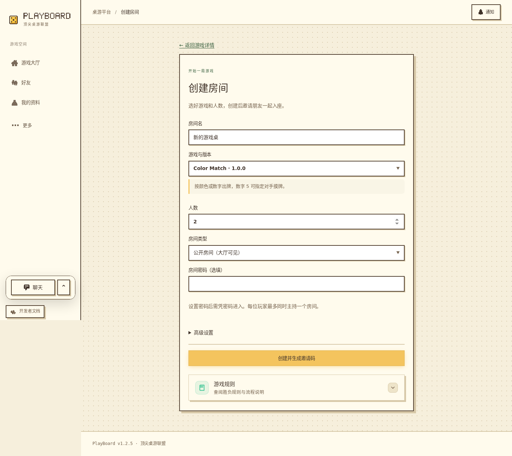
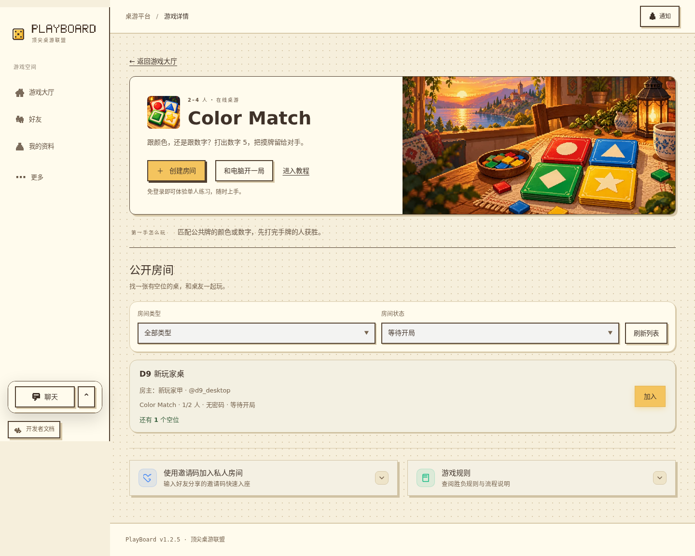
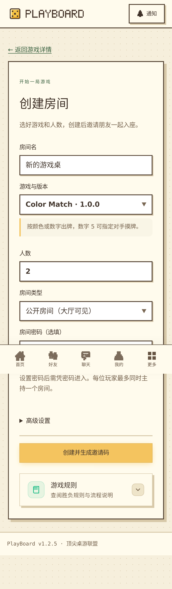
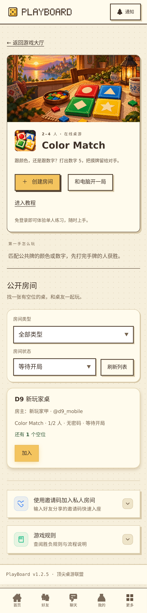

# D9 开局入口修复（2026-11-11，候选 1.2.5）

D8 确认的两项阻力已修复并完成本地验证：登录后返回原游戏的创建页，收起的桌面聊天入口避开公开房间的加入按钮。基于 main `6bcb95c` 独立开发，未改变原工作区或混入旧游戏、回放及导航改动。

## 实现与复现依据

问题来自已提交的 [D8 检查 / PR #64](https://github.com/PlayBoardgameTogether/PlayBoardgameTogether/pull/64)：匿名从游戏详情点击创建，经注册、登录后固定回大厅；1440×900 默认聊天浮窗覆盖公开房间加入按钮中心。D8 的实测和截图是历史证据，本轮重新通过真实双端链路检查修复结果，不把历史用例当成本轮通过。

- **认证续接**：NewRoomPage 将经过正常路由生成的创建目标放入 history state；登录/注册站内链接只传递通过校验的目标，注册成功保留原公开用户 ID。刷新仍保留意图，登录成功回原精确版本表单；登录错误可重试，取消后普通登录回大厅。没有自动创建、自动准备或新建房 API。
- **返回目标约束**：`auth/room-creation.ts` 将浏览器状态作为 unknown，只接受 `/rooms/new` 或已知游戏精确版本的 `/new` 路由、最多 256 字符，丢弃无关字段。外站、协议相对 URL、路径穿越、编码路径、query/hash 与其他业务目标被拒绝。没有将秘密字段写入 URL 或持久缓存。
- **聊天避让**：普通平台桌面页收起的聊天入口放入左导航底部，开发者入口上方；761–1100px 对齐既有窄侧栏。展开后的双频道浮窗、通知、草稿和游戏桌面的原位置保留。手机继续使用原底部聊天入口，无新主题或依赖。
- **版本**：平台 **1.2.4 → 1.2.5（PATCH）**，兼容的已有流程缺陷修复，README 同步。没有协议、SDK、数据库迁移、游戏实现、来源锁或官方登记变化。

## 当前运行画面

以下四张来自本轮真实 E2E，均已实际打开核对；创建页在提交前采集，列表仅包含本轮专用测试账号，没有邮箱、验证码、密码、session 或邀请码。手机为 390×844 CSS px；长页中固定导航位于采集时视口位置，不代表页面流内布局。

## 本轮验证

测试库为既有 PostgreSQL 17 测试容器回环 **15441** 上新建的 `playboard_d9_test_20261111`，与 scratch、开发/生产及此前测试库不同。原测试准备、迁移、游戏同步和资源校验链完整执行；共享此库的 E2E 批次串行运行。注册发码由原 E2E 注入传输投递至私有测试收件箱，不是生产 SMTP 收件证明。

| 命令 / 场景 | 实际结果 |
| --- | --- |
| `pnpm install --offline --frozen-lockfile` | 成功，无依赖/锁文件升级 |
| `pnpm --config.verify-deps-before-run=false typecheck` | 全工作区及既有测试配置通过 |
| 同选项 `lint` | ESLint、20 个源码根的 AST 边界和格式检查通过 |
| 同选项 `test tests/unit/room-creation-continuation.test.ts` | 3/3，通过，覆盖安全返回目标及无关字段丢弃 |
| 同选项 `build` | 完整工作区、生产 bundle/API runtime、隔离 ZIP 恢复及 AI worker 检查通过；保留既有 model-viewer 大 chunk 提示 |
| 同选项 `test:e2e --config .data/d9/e2e.config.ts tests/e2e/new-player-start.spec.ts tests/e2e/registration.spec.ts` | 新流程双端 6/6；既有注册 5/6，手机真实注册第二次发码触发正确的 IP 限流。合批共 11/12；不计为单批全通过 |
| 原准备链下同命令仅选择 `registration.spec.ts --project mobile --grep 'registers a real account' --output .data/d9/e2e-registration-retry` | 失败项单独 1/1 通过，无 skip；最终 12 个独立业务用例分批全部通过，不重复累计 |
| 同选项 `exec playwright test --config tests/config/ui.config.ts tests/e2e/social-shell.spec.ts tests/e2e/platform-shell.spec.ts --output .data/d9/ui` | 22/22，通过，无 skip；生产预览、受控公开 DTO，检查平台导航、加载失败恢复、登录重复提交、聊天频道/草稿/通知，不冒充真实联机 |
| 截图、链接、版本、差异检查 | 四张运行截图已查看，README/根版本一致，`git diff --check` 通过 |

真实新流程每端使用一个网页新注册账号及另一个已准备账号，通过 session/HTTP/WS 完成公开建房、加入、入座、双方准备、房主开局；双方 revision 0→1，行动后刷新恢复 1。没有 mock 创建/加入/动作，没有读取对手私密视图。认证往返、注册/登录刷新、错误密码、取消、普通登录及不可用精确版本均覆盖；登录成功本身没有发出建房请求。

加入按钮在 1440/1280/761px、亮/暗主题下，滚动到操作位置与键盘聚焦后中心命中自身、无整页横向溢出；手机真实链路为 390×844。既有平台回归还覆盖 320/844/1440px 登录及游戏头部 768/1024/1440px。聊天展开/收起、私聊/公共频道草稿、通知和导航通过。没有新增动效或延长原过渡。

初次临时 E2E 配置继承了相对 `globalSetup`，浏览器测试尚未开始即报模块找不到；改为绝对路径后经原准备链重跑。后续合批的一分钟内累计六次发码，超过原每 IP 五次限额；失败上下文明确为限流提示。未调整限流、测试断言或生产配置，单独重跑失败项通过。用例切换期间 Vite 记录过 WS EPIPE，双方正式同步、行动、恢复断言及 pageerror 检查通过；不隐去该日志。临时配置、完整日志及截图留在忽略目录 `.data/d9/`。

## 交付状态与限制

D8 PR #64 仍待合并。本轮尝试收尾 D8 时，自动审批拒绝修改 main，理由为“推进每日任务”未明确授权此次合并；没有改用其他方式绕过，已请求用户明确批准 D8 及验证后 D9 合并/服务器同步。D9 功能分支独立基于当前 main，不包含 D8 未合并提交，合并前需再次核对 main、精确 head 及文档冲突。

生产只读复核 **2026-11-11 23:03:40（北京时间）**：current.json、实际 API cwd 与运行 package.json 一致为 **6bcb95c / 1.2.4**；systemd active/running，NRestarts=0。23:04:53 匿名 Chromium 双端复核首页/详情及 `/health/ready` 均 200、database.ready=true、无 pageerror；创建仍进入旧版登录页。候选 1.2.5 尚未合并、发布或部署；原生产数据库、配置、资源、监督脚本与用户工作区保持。提交/PR 的最终结果在成功后另记。

未验证真机、Safari/WebKit、屏幕阅读器、完整键盘路径、软键盘、多个房间数量、邀请码/密码房、收费模型及完整终局；本轮未改后端行为，不重复无影响的全量集成或游戏回归。D3 生产注册闭环、D5 新包发布/生产主动安装继续保留原条件。D10 电脑陪玩说明为下一独立主题，尚未实施。

主提交 **d5dde131e79d22121d561ac52788abbd4c5460c7** 已推送 `codex/d9-start-flow`，创建 [PR #65](https://github.com/PlayBoardgameTogether/PlayBoardgameTogether/pull/65)，面向 main、状态 open。Git 推送经旧 origin 正常重定向到已确认组织仓库，未改远程配置；首次提交因无作者配置中止，随后仅本次命令使用既有代理身份 Codex 成功提交，不改全局身份。D8 #64 与 D9 #65 均待明确合并授权，两个分支及证据目录保留；没有执行已合并分支清理或服务器更新。此后仅补充内部交付事实，不重复升版或代码验证。

## 获准交付与 main 整合（2026-11-11）

用户已明确同意 D8/D9 合并及服务器同步。重新核对两个 PR 的完整文件/提交、精确 head、pins success 及无阻塞审查后，D8 #64 已合并为 `05dd7de400b90b2d79262ccc9fb1d5417e15b587`。D9 先整合该最新 main，只处理计划/进度文档冲突并保留双方记录；运行代码、测试和锁文件与 `5e7009f` 的已验证树相同，因此不重复无变化业务检查。最终 D9 head/合并提交、运行 SHA/版本、备份与双端公网验收在实际完成后另记。此前授权阻塞已解除。
